# SimFoundry Pipeline Overview

SimFoundry는 real-world scene을 찍은 RGB video 한 편으로 sim-ready simulation scene을 자동으로 만들고, 이를 robot policy의 evaluation과 training에 쓰는 real-to-sim pipeline입니다. 논문은 Extraction → Generation → Augmentation의 세 stage와 Background Reconstruction으로 설명하고, 저장소는 이를 Pipeline A·B·C로 나눕니다.

## Overview

- [Input](#input): real-world scene을 찍은 RGB video
- [1. Extraction](#1-extraction-pipeline-a-stage-15) (Pipeline A, stage 1–5): depth와 ground plane을 추정해 scene을 simulator world frame에 맞추고, object를 하나씩 segment함
- [2. Generation](#2-generation-pipeline-a-stage-614) (Pipeline A, stage 6–14): object마다 mesh를 생성해 scene에 align하고, collision geometry·mass·friction을 붙여 OmniGibson scene으로 export함
- [Background Reconstruction](#background-reconstruction): object 밖의 room과 desk를 따로 복원해 scene에 붙임
- [3. Augmentation](#3-augmentation-digital-cousins-pipeline-b) (Pipeline B): digital cousins로 object·scene·task variation을 늘림
- [Human-in-the-loop Scene Editing](#human-in-the-loop-scene-editing): pipeline이 틀린 object pose·scale과 camera를 사람이 고침
- [4. Applications](#4-applications-pipeline-c) (Pipeline C): demonstration을 모아 증강한 data로 policy를 training하고, simulation에서 policy를 evaluation해 real-world success rate를 예측함

## Input

[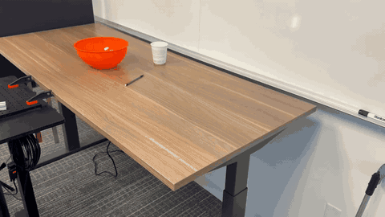](docs/assets/example_videos/PutCupInBowl.mp4)

Real-world scene을 찍은 raw RGB video 한 편입니다(예: cup과 bowl이 놓인 desk). Stereo camera image도 입력으로 받습니다. 별도의 human annotation은 필요 없습니다.

## 1. Extraction (Pipeline A, stage 1–5)

Video에서 object별 RGB-D crop과 segmentation mask를 얻는 stage입니다.

1. Video에서 representative RGB frame 하나를 고릅니다.
2. FoundationStereo 또는 Depth Anything으로 depth map을 추정하고, camera intrinsics로 scene point cloud를 만듭니다.

   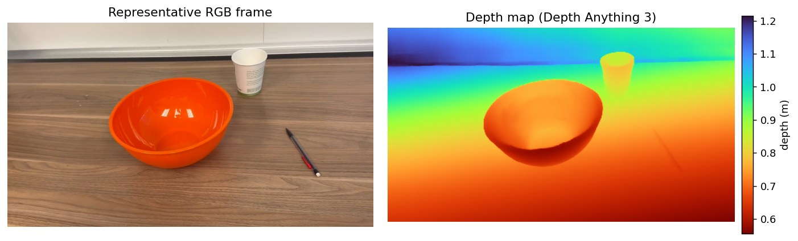

   *Depth map: 우리 재현에서 PutCupInBowl.mp4의 representative frame을 Depth Anything 3로 추정한 것(0.56–1.22 m).*

   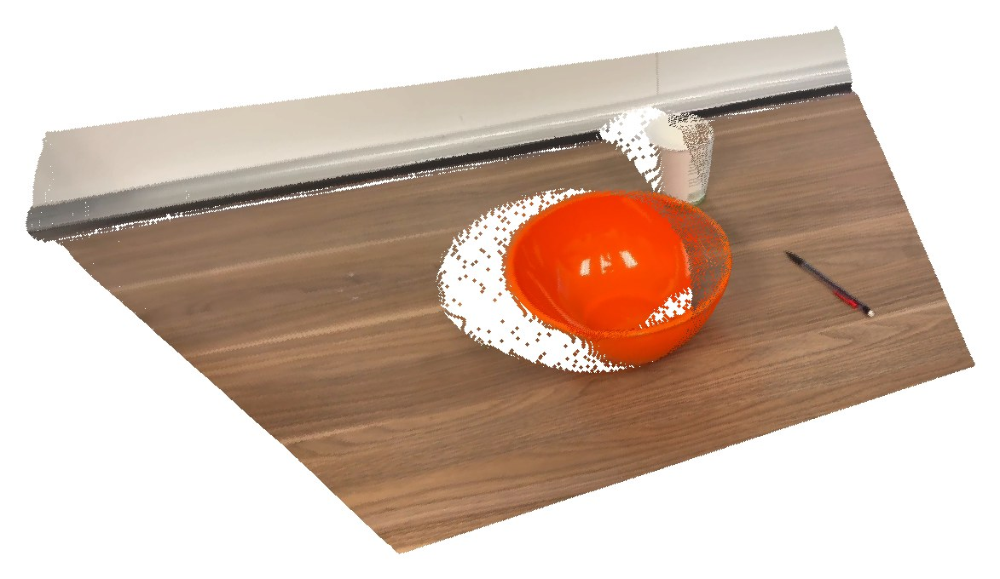

   *Scene point cloud: 이 depth map을 camera intrinsics로 lift한 112,896 points를 비스듬한 시점에서 본 것. Single view라서 object 뒤쪽(흰 영역)은 비어 있습니다.*

3. SAM3로 ground plane(desk surface)을 찾습니다.

   *SAM3 text prompt는 설정의 후보(desk → table → counter)를 차례로 시도해 score 0.5를 처음 넘는 것을 쓰고, 셋 다 실패하면 VLM이 이미지 속 support surface 이름을 제안해 다시 시도합니다.*

   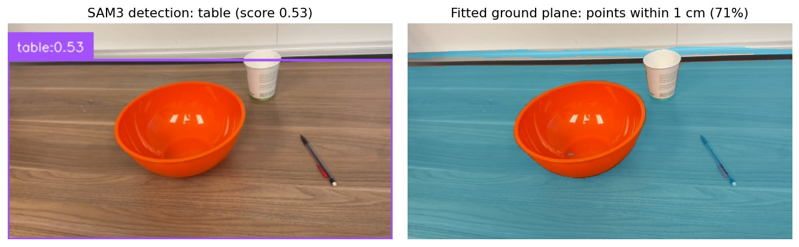

   *Ground plane: SAM3가 table을 찾고(왼쪽), 그 영역의 point에 RANSAC으로 plane을 맞춘 결과(오른쪽). Plane에서 1 cm 안에 드는 point(전체의 71%)를 파랑색으로 칠했고, bowl과 cup은 plane 위에 있어 빠집니다.*

4. Ground plane을 기준으로 scene을 simulator world frame(ground가 z = 0)에 align합니다.
5. Iterative decomposition: scene-understanding VLM이 object를 detect하고 SAM3가 mask를 딴 뒤, 그 object를 image·depth inpainting으로 지우고 다시 찾습니다. Foreground object가 남지 않을 때까지 반복합니다.

   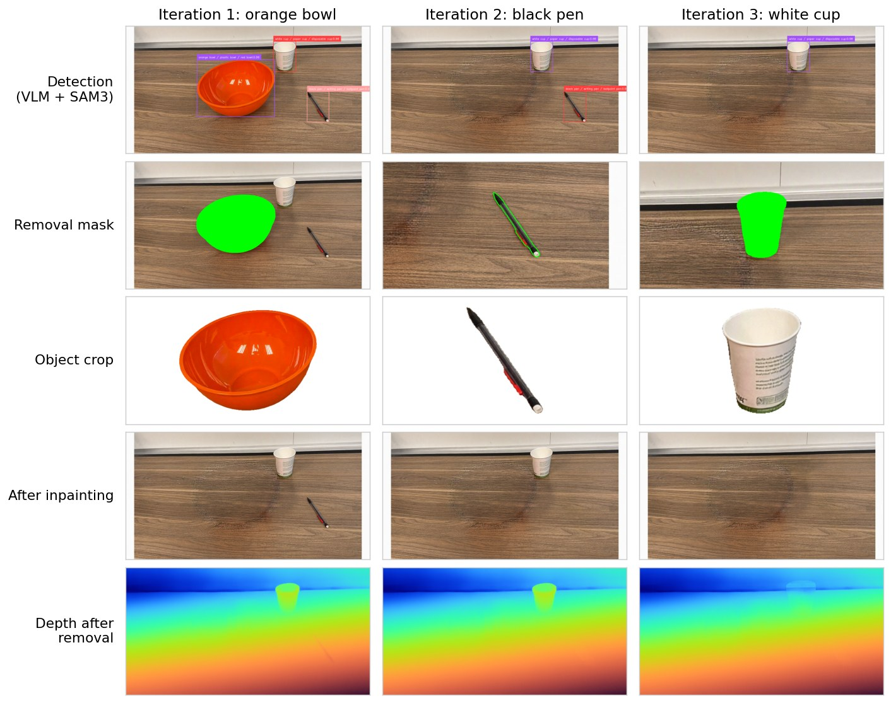

   *Iterative decomposition: 우리 재현에서 VLM이 object 3개(orange bowl, white cup, black pen)를 찾고, iteration마다 하나씩 SAM3 mask로 잘라 낸 뒤 image·depth에서 지웠습니다(bowl → pen → cup). 열이 iteration이고, 위에서부터 detection, image model에 준 removal mask, object crop, inpainting 결과, 지운 뒤 다시 추정한 depth입니다. Bowl 자리에는 inpainting 흔적이 남았습니다.*

## 2. Generation (Pipeline A, stage 6–14)

Object마다 sim-ready asset을 만들고, 하나의 scene으로 compose하는 stage입니다.

6. Object crop을 image generation model로 깨끗하게 upsample합니다.

   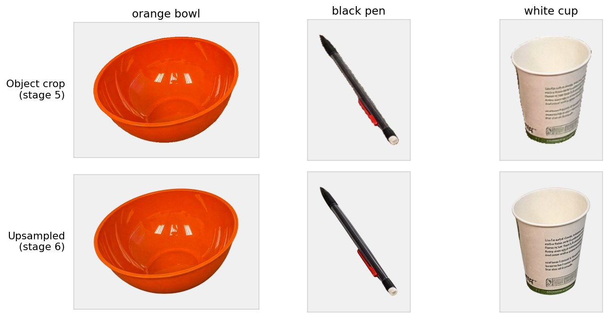

   *Upsample: 위는 stage 5가 잘라 낸 object crop, 아래는 image model이 깨끗하게 다시 그린 결과입니다. Stage 7은 아래 사진에서 mesh를 만듭니다.*

7. Hunyuan3D-2.1로 upsample한 사진 한 장에서 textured mesh를 생성합니다(2D-to-3D).

   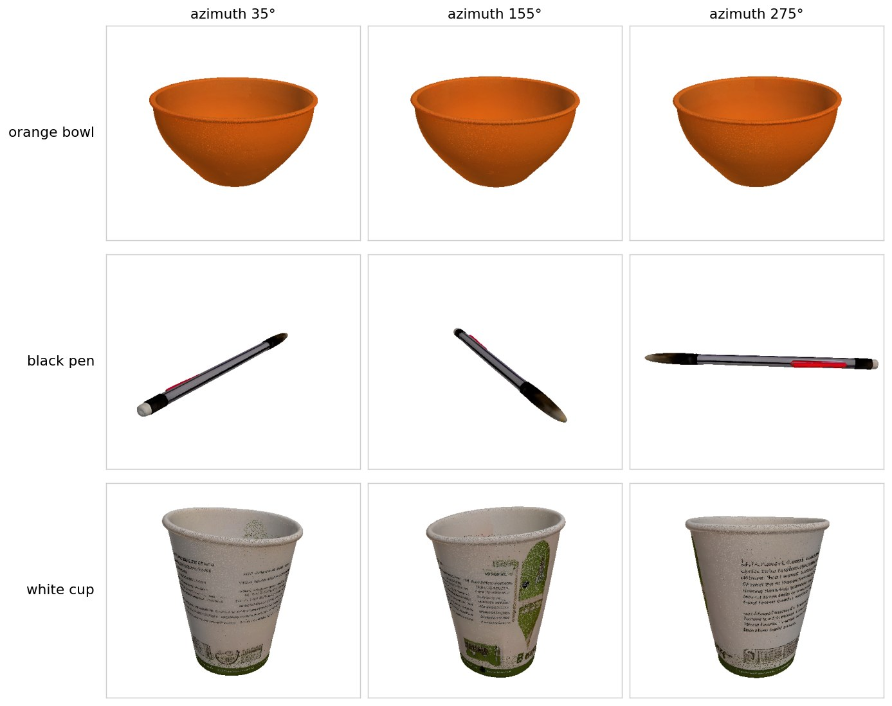

   *Mesh: Hunyuan3D-2.1이 만든 textured mesh를 세 방향에서 본 것입니다. 사진에 보이지 않던 뒷면도 채워져 있습니다.*

   [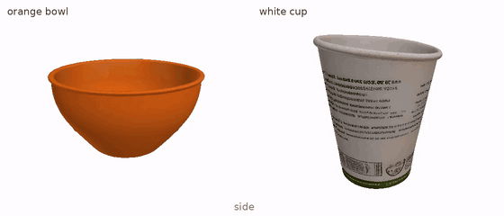](assets/readme/mesh_inside_bottom.mp4)

   *Inside·bottom: bowl과 cup mesh를 옆 → 안쪽(위에서) → 바닥(아래에서) 순서로 돌려 본 영상입니다(13초). Cup 바닥처럼 사진에 없던 면은 Hunyuan3D가 추정해 채운 것입니다.*

8. Mesh를 scene point cloud에 align하고, FoundationPose로 object pose를 refine합니다.

   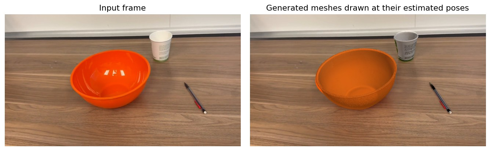

   *Pose: 생성된 mesh를 추정한 pose로 input frame의 camera에 그린 것(오른쪽)입니다. 세 object 모두 실제 위치에 겹칩니다.*

9. Articulated object(drawer, cabinet)는 articulation module이 movable part를 찾아 mesh를 나누고 joint parameter를 만듭니다. 이 scene에는 해당 object가 없습니다.
10. Object들을 scene 하나로 compose합니다.
11. CoACD로 collision geometry를 만들고, VLM에게 object별 mass와 friction을 묻습니다.

    | Object | Size (cm) | Collision parts | Friction | Mass (원본) | Mass (Ch. 29) | 실물 참고 |
    |---|---|---|---|---|---|---|
    | orange bowl | 25.7 × 25.8 × 13.7 | 32 | 0.5 | 500 g | 293 g | 수백 g |
    | black pen | 12.8 × 0.8 × 0.6 | 1 | 0.4 | 10 g | 4.5 g | 약 6 g |
    | white cup | 9.4 × 9.1 × 11.0 | 32 | 0.5 | 70 g | 15 g | 약 10 g |

    *Sim-ready: 우리 재현의 stage 11 출력입니다. Collision parts는 CoACD가 나눈 convex 조각 수입니다. Mass는 원본 방식(VLM에 한 번 물음)의 값과, 재현 기록 29장에서 고친 방식의 값을 함께 적었습니다.*

12. PyBullet(물리 엔진)으로 object들을 책상 위에 안정되게 내려놓습니다.

    *8번에서 추정한 pose는 조금씩 틀려서, object가 책상에 살짝 파묻히거나 서로 겹치거나 떠 있을 수 있습니다. 그래서 object들을 그 pose로 넣고 중력을 건 뒤, 겹친 부분이 밀려나고 가만히 놓일 때까지 simulation을 돌립니다. 멈춘 위치와 자세가 최종 pose가 되어, simulator에서 시작하자마자 object가 튀거나 떨어지지 않습니다.*

13. Object(URDF)를 USD로 convert합니다.
14. OmniGibson scene으로 export합니다.

    *Background(3DGS나 mesh)는 export한 scene과 같은 좌표계에 붙입니다. 그래서 object가 영상 속 원래 자리에 있어야 책상·robot과 맞고, real-world와 같은 배치여야 sim에서 잰 성공률을 실제와 비교할 수 있습니다. Scene cousins도 이 배치에서 출발합니다.*

    [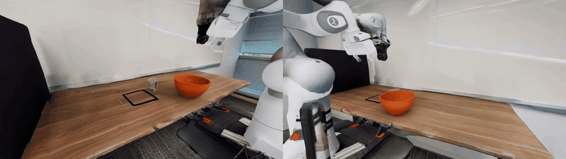](assets/readme/demo_background.mp4)

    *Background: 같은 scene에 DROID 작업대 mesh background를 붙여, robot 양옆의 camera 두 대로 찍은 영상입니다(45초, GIF는 3배속). 이 background는 이 영상에서 복원한 것이 아니라 저자들이 미리 scan해 공개한 것입니다(재현 기록 12장).*

## Background Reconstruction

Object 밖의 room과 desk는 세 가지 방법 중 하나로 만듭니다. 논문의 robot experiment는 mesh background를 썼습니다.

| Method | Input | Process |
|---|---|---|
| Automatic | Object reconstruction에 쓴 같은 video | Foreground object를 지운 video(VOID two-pass inpainting)와 metric depth·camera pose(DA3)로 depth-supervised 3DGS를 학습하고, rigid transform으로 simulator world frame에 붙임 |
| Manual | Object를 치우고 따로 찍은 background-only video | 그 video로 3DGS를 학습하고 interactive editor에서 align |
| Mesh | Scan app(Scaniverse)으로 찍은 room | Mesh background를 그대로 사용 (robot experiment의 `droid_v1`) |

## 3. Augmentation: Digital Cousins (Pipeline B)

복원한 scene을, task-relevant semantics는 유지하면서 object instance·scene layout·task specification을 바꾼 여러 variant로 늘립니다.

- **Object cousins (stage 1–5)**: 기능(affordance)은 같고 모양이나 겉모습이 다른 object를 새로 만듭니다.
  1. VLM이 object를 기능 부품으로 나눕니다(가위: Handle, Blade, Pivot Point).
  2. 부품마다 geometry·topology·visual 변형 후보를 두 개씩 문장으로 냅니다(예: Handle의 geometry "finger loop를 길게").
  3. 고른 변형을 편집 지시문으로 바꿔 image model이 cousin 사진을 그립니다. 원본은 Gemini 3 Pro Image, 우리 재현은 Qwen-Image-2.1-Turbo입니다.
  4. VLM이 그 사진을 다시 보고 실제로 있을 법한지, 장면에 어울리는지 yes/no로 판정합니다. 통과한 사진만 다음 단계로 갑니다.
  5. Hunyuan3D-2.1이 사진 한 장으로 mesh를 만들고(stage 3), collision·mass·friction을 붙여(stage 4) USD로 바꿉니다(stage 5).

  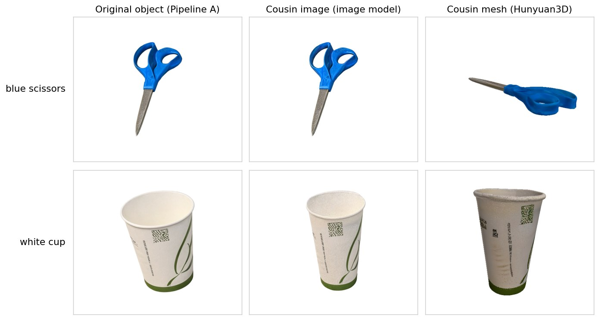

  *PutMarkerInCup 재현에서 만든 object cousin입니다. VLM은 가위의 손잡이 고리를 길게, 컵의 높이와 지름 비율을 바꾸도록 제안했고, 컵만 눈에 띄게 달라졌습니다.*
- **Scene cousins (stage 6)**: OnTop, RightOf 같은 spatial predicate로 layout을 바꾸고, distractor object를 추가합니다.
- **Task cousins (stage 7)**: scene의 object로 가능한 다른 manipulation task를 VLM이 제안하고, simulator가 판정할 수 있는 goal specification으로 바꿉니다.

## Human-in-the-loop Scene Editing

Pipeline B와 C 사이에서 사람이 editor로 pipeline이 틀린 부분을 고칩니다. 주된 대상은 object pose·scale과 camera pose이고, 이후 stage는 모두 이 correction을 이어받습니다. 저장소에는 빠른 browser-based editor와, 실제 rendering과 physics를 보여 주는 OmniGibson editor가 있습니다.

## 4. Applications (Pipeline C)

만든 scene으로 demonstration data를 생성해 policy를 training하고, policy를 evaluation합니다.

- **Demonstration collection (stage 2)**: teleoperation으로 위에서 생성한 장면마다 사람이 demonstration을 10–15개 모읍니다.
- **Data generation (stage 3–6)**: demonstration에 subtask annotation을 하고 waypoint를 추출한 뒤, MimicGen으로 cousin scene들에 옮겨 demonstration 수를 늘립니다. Material, camera, lighting은 domain randomization으로 바꿉니다.

  > **MimicGen**
  >
  > 사람이 만든 시연 몇 개를 수백 개로 늘리는 data generation 방법입니다(Mandlekar 외, CoRL 2023). 시연을 'cup 잡기', 'bowl에 놓기'처럼 object 기준의 subtask로 나누고, 구간마다 gripper 궤적을 그 object에 대한 상대 위치로 저장합니다. Object 위치나 종류가 다른 새 scene에서는 그 궤적을 새 위치에 맞춰 옮기고, 구간 사이는 motion planning(SimFoundry는 CuRobo)으로 잇습니다. Simulation에서 실행해 성공한 것만 dataset에 남깁니다.
- **Sim-to-Real Policy Training**: 그 data로 training한 policy가 real robot에서 얼마나 나아지는지 봅니다(논문 +17/21/40%).
- **Real-to-Sim Policy Evaluation (stage 1)**: π0, π0.5, GR00T 같은 공개 policy를 finetuning 없이(zero-shot) simulation scene에서 rollout해, sim success rate가 real-world success rate를 예측하는지 봅니다(논문 Table G.1의 Pearson r과 MMRV).

## Reproduction Status

단계별 재현 상태와 실험 기록은 [repro/README.md](repro/README.md)에 따로 정리했습니다.

## References

- [SimFoundry paper (arXiv 2606.28276)](https://arxiv.org/abs/2606.28276), Section 4와 Appendix
- [NVlabs/SimFoundry code](https://github.com/NVlabs/SimFoundry), `scripts/pipeline/`의 Pipeline A·B·C
- [Reproduction log](repro/README.md), `repro/README.md`

SimFoundry 원래 README(설치, Quick Start, citation)는 [README_upstream.md](README_upstream.md)에 있습니다. NVIDIA의 SimFoundry 코드는 [Apache License 2.0](LICENSE)을 따릅니다.
